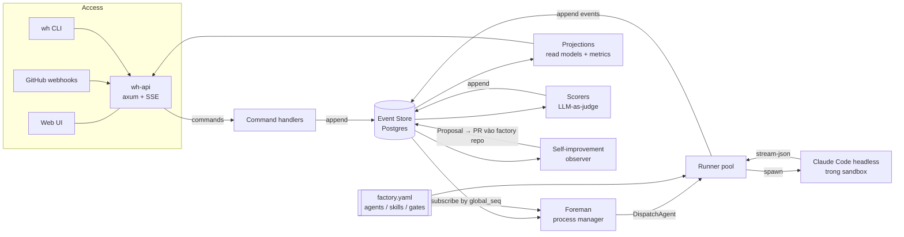
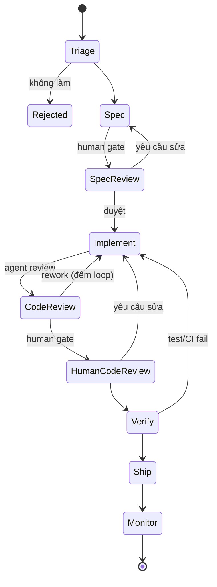

# WorkHub — Thiết kế kiến trúc (đề xuất v0.1)

> WorkHub là một **agent factory**: nơi các agent Claude phối hợp đi hết vòng đời một task (triage → spec → implement → review → verify → ship), mọi bước đều phát sinh **event**. Từ dòng event đó, WorkHub đo lường (chi phí, thời gian, tỉ lệ fail, số lần làm lại, số lần người phải can thiệp) và **feed ngược lại cho một agent cải tiến** để đề xuất thay đổi quy trình.
>
> Ngôn ngữ: **Rust**. Phong cách: **event-driven, event sourcing + CQRS**.

---

## 1. Nguyên tắc thiết kế

1. **Event là nguồn sự thật duy nhất.** Mọi thay đổi trạng thái (task, run, gate, đề xuất) được ghi thành event bất biến vào event store. Bảng đọc (dashboard, danh sách run) chỉ là *projection* có thể xoá và dựng lại.
2. **Đo lường là sản phẩm phụ miễn phí.** Vì mọi bước đã là event, metrics không cần instrument riêng — chỉ cần thêm projection.
3. **Factory-as-code.** Quy trình (stage, gate, agent, prompt/skill, model, budget) nằm trong file version-controlled. Mỗi run ghi lại `factory_version` → so sánh được trước/sau một thay đổi quy trình.
4. **Human-in-the-loop ở các gate.** Spec, code, product đều có điểm duyệt; agent cải tiến *chỉ đề xuất*, con người duyệt.
5. **Agent runtime là plugin.** Lõi không phụ thuộc Claude Code; Claude Code headless là adapter đầu tiên.

---

## 2. Bức tranh tổng thể



Map với "The Factories Stack" của Warp Factories (sản phẩm tham khảo):

| Tầng (Warp) | Thành phần WorkHub |
|---|---|
| 00 Factories-as-code | `factory.yaml`, agent definitions, automation definitions, runner config — crate `wh-factory` |
| 01 Data & context | Event store, transcripts, artifacts (PR, report), memory — `wh-eventstore`, `wh-artifacts` |
| 02 Compute | Runner + sandbox (git worktree → Docker) — `wh-runner` |
| 03 Inference | Model routing theo agent/stage trong factory config |
| 04 Improvement | Metrics projections, Scorers, Benchmarks, Self-improvement — `wh-metrics`, `wh-scorer`, `wh-improver` |
| 05 Orchestration | Foreman (triage/spec/impl/review/verify), automations (trigger/cron), human gates — `wh-foreman` |
| 06 Access | Web UI, API, CLI, GitHub (sau: Slack, Linear/Jira, MCP server) — `wh-api` |

---

## 3. Mô hình miền (domain)

| Aggregate | Ý nghĩa | Stream id |
|---|---|---|
| **Factory** | Một quy trình + repo đích (vd. "wilson") | `factory-{id}` |
| **Task** | Một work item đi qua các stage (idea/bug → shipped) | `task-{id}` |
| **Run** | Một lần thực thi top-level cho task (có thể chứa nhiều agent session) | `run-{id}` |
| **AgentSession** | Một lần chạy một agent cụ thể (triage, spec, code, review…) | `session-{id}` |
| **Gate** | Điểm duyệt của người (spec/code/product) | thuộc stream Task |
| **ScoreResult** | Kết quả chấm một session/run bởi scorer | `score-{id}` |
| **BenchmarkRun** | Một lần chạy suite benchmark trên một biến thể factory | `bench-{id}` |
| **Proposal** | Đề xuất cải tiến từ improver + trạng thái duyệt | `proposal-{id}` |

Quan hệ: `Factory 1─n Task 1─n Run 1─n AgentSession`; `AgentSession 1─n ScoreResult`; `Proposal n─n (Session làm bằng chứng)`.

### Vòng đời Task (state machine trong Foreman)



Mỗi stage và gate đều có thể cấu hình bật/tắt, agent nào, model nào, budget/timeout bao nhiêu trong `factory.yaml`.

---

## 4. Event model

### 4.1 Envelope (chung cho mọi event)

```rust
pub struct EventEnvelope {
    pub event_id: Uuid,          // UUIDv7 — sắp xếp theo thời gian
    pub global_seq: i64,         // thứ tự toàn cục, do store cấp
    pub stream_id: String,       // "task-…", "session-…"
    pub stream_version: i64,     // optimistic concurrency
    pub event_type: String,      // "AgentSessionCompleted"
    pub schema_version: u16,     // để upcast khi payload thay đổi
    pub payload: serde_json::Value,
    pub meta: EventMeta,
}

pub struct EventMeta {
    pub occurred_at: DateTime<Utc>,
    pub factory_id: FactoryId,
    pub factory_version: String, // git sha của factory-as-code → so sánh A/B
    pub correlation_id: Uuid,    // = task_id: gom mọi thứ của một task
    pub causation_id: Option<Uuid>, // event gây ra event này → dựng cây nhân quả
    pub actor: Actor,            // Human{user} | Agent{session} | System{component}
}
```

`correlation_id` + `causation_id` là chìa khoá để timeline (như màn Run detail của Warp) và phân tích "vì sao task này tốn 13h".

### 4.2 Danh mục event chính

**Task**: `TaskCreated{source, title, body, factory, benchmark, external_ref}`, `TaskTriaged{priority, kind, estimate}`, `StageEntered{stage, feedback}`, `StageExited{stage, outcome, summary, session}`, `GateRequested{gate, stage}`, `GateDecided{gate, stage, approved, reviewer, comment}`, `TaskBlocked{stage, reason}`, `TaskResumed{stage, comment}`, `TaskCompleted{branch}`, `TaskCancelled{reason}`.

**Pull request** (phase 8, cũng trên stream `task-{id}`): `TaskShipped{repo, pr_number, pr_url, branch, commit, created}`, `PrReviewed{review_id, reviewer, state, body, comments[], submitted_at}`, `PrChecksCompleted{commit, conclusion, failed[{name, url, log}]}`, `PrMerged{merged_at, merged_by}`, `PrClosed{closed_at}`.

**Run / AgentSession** (giàu dữ liệu nhất — đây là nguyên liệu cải tiến):
- `AgentDispatched{agent, model, stage, prompt_ref, skills, budget}`
- `AgentSessionStarted{runner_id, sandbox}`
- `AgentToolCalled{tool, duration_ms, ok}` *(ghi tóm tắt; transcript đầy đủ lưu artifact)*
- `AgentUsageReported{input_tokens, output_tokens, cache_read, cache_write, cost_usd}` *(cộng dồn hoặc cuối phiên)*
- `HumanInterventionRecorded{kind: follow_up|steer|handoff, by}`
- `AgentSessionCompleted{outcome, num_turns, duration_ms, cost_usd, artifacts[]}`
- `AgentSessionFailed{failure_class, message, retryable}`

**Quality / Improvement** (stream `score-{id}`): `ScoreStarted{scorer, target_session, task_id, agent, stage, model, pass_threshold, manual}`, `ScoreRecorded{score, pass, classification, rationale, cost_usd, usage}`, `ScoreFailed{message, cost_usd}`.

**Benchmark** (stream `bench-{id}`): `BenchmarkRequested{suite, suite_file, git_ref, proposal, label, repeat, cases}`, `BenchmarkStarted{factory, factory_version, factory_commit, suite_version, planned, pid}`, `BenchmarkCaseStarted{case, repeat, task_id}`, `BenchmarkCaseFinished{case, repeat, task_id, task_status, passed, check, cost_usd, duration_ms, sessions, rework_loops, message}`, `BenchmarkCompleted{cases, passed, cost_usd, duration_ms, aborted}` | `BenchmarkFailed{message}`.

**Proposal** (stream `proposal-{id}`): `ImprovementRequested{factory, trigger, focus}`, `ImprovementStarted{base_factory_version, window_days, sessions_observed}`, `ProposalCreated{title, rationale, expected_impact, evidence[], files[], diff, branch, commit, proposed_factory_version, cost_usd}` | `ImprovementSkipped{reason}` | `ImprovementFailed{message}`, `ProposalDecided{approved, reviewer, comment}`, `ProposalRolledOut{factory_version, commit}`.

### 4.3 Phân loại lỗi (`failure_class`)

Cần cố định từ đầu để thống kê tỉ lệ fail có ý nghĩa:
`timeout` · `budget_exceeded` · `tool_error` · `test_failed` · `ci_failed` · `review_rejected` · `gate_rejected` · `spec_ambiguous` · `env_setup` · `agent_gave_up` · `infra` · `unknown`.

---

## 5. Thành phần

### 5.1 Event store (`wh-eventstore`)
- **Postgres** là store + bus cho MVP: bảng `events` append-only, `global_seq BIGSERIAL`, unique `(stream_id, stream_version)` để chống ghi đè đồng thời.
- Subscriber đọc theo `global_seq > checkpoint`, lưu checkpoint riêng mỗi consumer (`consumer_checkpoints`) → **at-least-once**, handler phải idempotent (khóa theo `event_id`).
- `LISTEN/NOTIFY` để đánh thức consumer thay vì poll dày.
- Khi cần scale/phân tán: thêm **NATS JetStream** phía sau qua outbox — interface `EventBus` trừu tượng sẵn từ đầu.

### 5.2 Foreman (`wh-foreman`) — process manager
- Nghe event Task/Session, đọc state machine từ factory config, phát **command** (`DispatchAgent`, `RequestGate`, `AdvanceStage`, `RetrySession`).
- Không gọi LLM để điều phối trong MVP (deterministic, rẻ, dễ debug). Sau này có thể thêm "LLM foreman" cho quyết định mềm (vd. có cần spec không).
- Áp chính sách: retry tối đa N, giới hạn rework loop, budget mỗi task, escalate sang người.

### 5.3 Runner (`wh-runner`)
- Nhận `DispatchAgent`, tạo sandbox (**git worktree** riêng mỗi session; từ phase 7 có thể chạy agent trong **container Docker** trên worktree đó, cấu hình `sandbox:` trong factory), chạy agent, đọc stream, phát event.
- **Adapter Claude Code headless** (MVP): spawn `claude -p <prompt> --output-format stream-json` với `--model`, allowed tools, system prompt/skills theo agent definition. Parse từng dòng JSON → `AgentToolCalled`, `AgentUsageReported`; message `result` cuối cho cost, duration, num_turns.
- Trait `AgentRuntime` để thêm adapter khác (Claude API trực tiếp, Codex…) mà không đổi lõi.
- Transcript đầy đủ → `wh-artifacts` (filesystem/S3), event chỉ giữ tham chiếu.

### 5.4 Projections & Metrics (`wh-metrics`)
Read model trong Postgres (bảng riêng, dựng lại được từ event):

| Read model | Câu hỏi trả lời |
|---|---|
| `runs_view` | Danh sách run + trạng thái (Running/Complete/Failed/Blocked/Cancelled) |
| `run_timeline` | Gantt các session trong một run (như màn Run detail của Warp) |
| `session_facts` | 1 dòng / session: agent, model, stage, tokens, cost, duration, outcome, failure_class, factory_version |
| `task_cycle_times` | kickoff→PR, PR→first human review, review→merge, kickoff→merge |
| `stage_stats` | theo stage/agent: success rate, p50/p95 duration, cost TB, rework rate |
| `human_load` | số lần người can thiệp / PR, gate reject rate |

`session_facts` là bảng "fact" phẳng — cũng là input chính cho improver. Khi dữ liệu lớn, đẩy sang DuckDB/ClickHouse.

### 5.5 Scorers (`wh-scorer`)
- Scorer = định nghĩa trong factory repo: `target` (agent nào), `prompt` chấm (rubric), `model`, `pass_threshold`, `sampling_rate`, `budget_usd`, `include_failed`.
- Nghe `AgentSessionCompleted` (và `AgentSessionFailed` nếu `include_failed`) → chạy LLM-as-judge (model rẻ, không tool) trên task + prompt agent + câu trả lời cuối + diff commit + transcript rút gọn → `ScoreRecorded{score 0..1, pass, classification, rationale, cost}` hoặc `ScoreFailed`. Tự ghi cost của chính scorer (như "All-time scorer cost" của Warp).
- Ví dụ scorer của Warp: *Redundant Tests*, *Status Update Nudge*, *Computer-Use Ask*. WorkHub dogfood: `scope-discipline`, `test-evidence` (implementation), `review-evidence` (code-review).

### 5.6 Self-improvement (`wh-improver`)

Vòng lặp:

```
Observe  → định kỳ/khi vượt ngưỡng: đọc session_facts + score fail + gate reject + transcript mẫu
Diagnose → agent phân tích pattern (vd. "implement fail ci 30% vì quên chạy fmt")
Propose  → ProposalCreated: diff vào factory repo (prompt, skill, CLAUDE.md, gate, model, budget)
           kèm evidence (session ids) + kỳ vọng định lượng
Review   → con người duyệt trong Inbox (Warp hiển thị approval rate, vd. 13/51)
Rollout  → merge → factory_version mới
Measure  → so sánh metrics trước/sau theo factory_version; benchmark suite nếu có
```

- Đề xuất **luôn là một commit trên branch riêng** (`wh/proposal/<id>`) của repo chứa factory → audit được, revert được (local-only nên chưa mở PR GitHub).
- Improver tự đo hiệu quả bản thân: approval rate, cost, và delta metrics sau rollout.
- Đã triển khai ở phase 5, xem "Ghi chú phase 5" bên dưới.

### 5.7 Benchmarks (`wh-bench`)
Tập task cố định (có check chấm tự động) để chạy lại với các biến thể của factory (model, skill, prompt) → so sánh khách quan trước khi rollout, không phải chờ dữ liệu thật. Đã triển khai ở phase 6, xem "Ghi chú phase 6" bên dưới.

### 5.8 API & UI (`wh-api`, `web/`)
- **axum** REST + **SSE** để stream event live (timeline, trạng thái run).
- Màn hình (theo Warp Factories): Inbox (gate + proposal cần duyệt), Runs, Run detail (transcript + Timeline/Agents/Artifacts/Metadata), Dashboard (Productivity / Spending / Scorers), Agents, Scorers, Self-improvement, Factory definition (read-only, link về repo).
- Phase 6 thêm Benchmarks (suite, danh sách run, chạy run, so sánh hai run), trang chi tiết run benchmark (từng case kèm output của check), thẻ Benchmark trên trang proposal (base vs proposal) và banner "benchmark case" trên trang task.
- Phase 3 đã làm: Runs, Run detail (pipeline strip, duyệt gate / resume / cancel, Gantt session theo stage, stage outputs, transcript, raw events), Inbox (gate + blocked; proposal đợi phase 5), Dashboard, Factory. Phase 4 thêm Scorers (pass rate / cost theo scorer, kết quả gần đây), điểm trên từng session, ô pass rate + judge cost trên Dashboard. Phase 5 thêm Self-improvement (track record của improver, proposal, metrics theo factory_version kèm delta), trang proposal (diff, evidence, duyệt/áp dụng, before → after) và proposal trong Inbox. Agents để phase sau.

---

## 6. Factory-as-code (ví dụ)

```yaml
# factory/factory.yaml
name: workhub-dev
repo: github.com/<org>/<repo>
defaults:
  model: claude-sonnet-5-5
  budget_usd_per_task: 5.0
  max_rework_loops: 3

stages:
  - id: triage
    agent: triage
  - id: spec
    agent: spec
    gate: { kind: human, name: spec-review }
    skip_if: "task.kind == 'bug' && task.estimate == 'small'"
  - id: implement
    agent: implementation
    timeout: 45m
  - id: code_review
    agent: code-review
    on_reject: implement
  - id: human_review
    gate: { kind: human, name: code-review }
  - id: verify
    agent: verify
    on_fail: implement

agents:
  triage:         { file: agents/triage.md,  model: claude-haiku-5-5 }
  spec:           { file: agents/spec.md }
  implementation: { file: agents/implementation.md, skills: [skills/rust-fmt-check] }
  code-review:    { file: agents/code-review.md, model: claude-opus-5-5 }
  verify:         { file: agents/verify.md }

scorers:
  - id: redundant-tests
    target: implementation          # agent có session được chấm
    prompt: scorers/redundant-tests.md
    model: claude-haiku-5-5         # mặc định
    pass_threshold: 0.7             # score >= ngưỡng là pass
    sampling_rate: 0.5              # xác định theo (session, scorer)
    budget_usd: 0.25

improvement:
  prompt: improver/improver.md
  model: claude-opus-5-5
  budget_usd: 3.0
  window_days: 14                  # dữ liệu improver được xem
  min_sessions: 8                  # ít dữ liệu hơn thì không tự chạy
  interval_hours: 24               # định kỳ, chỉ khi có session mới
  max_open_proposals: 2
  triggers:                        # mỗi trigger bắn tối đa 1 lần / factory_version
    - { metric: stage_failure_rate, stage: implement, above: 0.3 }
    - { metric: stage_reject_rate, stage: code_review, above: 0.5 }
    - { metric: scorer_fail_rate, scorer: test-evidence, above: 0.4 }
```

---

## 7. Cấu trúc Rust workspace

```
WorkHub/
├── Cargo.toml                # [workspace]
├── crates/
│   ├── wh-core/              # types, IDs, Event enum, Command enum, failure_class
│   ├── wh-eventstore/        # Postgres store, subscriptions, checkpoints, EventBus trait
│   ├── wh-factory/           # parse + validate factory.yaml, state machine definition
│   ├── wh-foreman/           # process manager
│   ├── wh-runner/            # sandbox + AgentRuntime trait + claude_code adapter
│   ├── wh-metrics/           # projections / read models
│   ├── wh-scorer/
│   ├── wh-improver/
│   ├── wh-bench/             # benchmark suites, runs, comparison
│   ├── wh-artifacts/         # transcript / diff / report storage
│   ├── wh-api/               # axum, SSE
│   └── wh-cli/               # `wh` binary: task create, run, replay projection…
├── bins/workhubd/            # binary chạy mọi component trong 1 process (MVP)
├── migrations/               # sqlx migrations
├── factory/                  # factory-as-code cho chính WorkHub (dogfooding)
└── web/                      # UI
```

MVP chạy **một binary** (`workhubd`) chứa mọi consumer dưới dạng tokio task; ranh giới crate cho phép tách thành service sau mà không đổi code miền.

**Stack**: `tokio`, `axum`, `sqlx` (Postgres), `serde`/`serde_json`, `uuid` (v7), `chrono`, `tracing` + OpenTelemetry, `thiserror`/`anyhow`, `clap` (CLI).

---

## 8. Lộ trình

| Phase | Mục tiêu | Kết quả kiểm chứng |
|---|---|---|
| **0. Nền** ✅ | Workspace, event store, envelope, migrations, CLI replay | Ghi/đọc event, dựng lại projection từ đầu |
| **1. Một agent** ✅ | Runner + adapter Claude Code, `session_facts` | `wh run "task…"` → thấy cost/tokens/duration/outcome |
| **2. Pipeline** ✅ | Foreman + factory.yaml, triage→spec→implement→review→verify, gate qua CLI | Một task đi hết vòng, có rework loop |
| **3. Quan sát** ✅ | API + SSE + UI: Runs, Run timeline, Dashboard | Xem live, metrics cycle time/cost/fail rate |
| **4. Chất lượng** ✅ | Scorers | Pass rate theo scorer, cost scorer |
| **5. Tự cải tiến** ✅ | Improver + Inbox duyệt + so sánh theo factory_version | Proposal → PR → đo delta |
| **6. Benchmarks** ✅ | Suite task cố định + check ẩn, chạy trên factory tại một git ref, so sánh run (proposal vs base) | Proposal → benchmark base/proposal → so sánh pass rate/cost trước khi duyệt |
| **7. Docker sandbox** ✅ | Agent chạy trong container (image riêng, giới hạn tài nguyên, git chỉ đọc), cấu hình theo agent trong factory | Pipeline + benchmark chạy trong container, metrics ghi rõ sandbox |
| **8. GitHub (local)** ✅ | Ship stage push branch + mở PR bằng `gh`, theo dõi PR bằng polling (review, CI, merge), task từ issue có label, cycle time kickoff→PR→merge | Task đi tới PR merged, CI fail/yêu cầu sửa quay lại implement, dashboard có cycle time |
| **9. Mở rộng** | Slack/Linear, NATS (khi chạy nhiều máy) | — |

### Kế hoạch phase 8 (GitHub, giữ local-only) — chốt 2026-11-25 (đã làm, xem "Ghi chú phase 8")

Mục tiêu: khép vòng task → PR → merge để đo được phần quan trọng nhất (thời gian tới merge, số lần người yêu cầu sửa) và feed cho improver. Không dùng webhook: mọi thứ đi qua `gh` CLI + polling, nên vẫn chạy local, không cần mở port.

1. **Cấu hình opt-in theo factory** (`github:` trong factory.yaml): `repo` (owner/name, mặc định lấy từ remote), `remote` (mặc định `origin`), `base` (branch đích của PR), `draft`, `labels`, `poll_interval_sec`, và tuỳ chọn `ship_gate` (gate của người trước khi push, vì push/mở PR là hành động ra bên ngoài). Không có block `github:` thì mọi thứ như phase 7 (task dừng ở branch local). Benchmark không bao giờ push.
2. **Ship**: sau stage cuối (và gate nếu có), WorkHub (không phải agent) `git push <remote> wh/task/<id>` rồi `gh pr create` với title/body từ task + tóm tắt các stage → `TaskShipped{pr_url, pr_number, branch, commit}`. Idempotent: id PR ghi trong event, chạy lại thì tìm PR đã có cho branch (`gh pr list --head`) thay vì tạo mới. Lỗi push/gh → task blocked với lý do rõ ràng (`infra`/`env_setup`), resume được.
3. **Theo dõi PR** (consumer/worker mới, chạy trong `wh foreman` / `wh serve --foreman`, tắt bằng `--no-github`): poll các task đã ship chưa đóng bằng `gh pr view --json state,reviews,statusCheckRollup,mergedAt,comments`, chỉ ghi event khi trạng thái đổi: `PrReviewed{reviewer, state, body}`, `PrChecksCompleted{conclusion, failed[]}`, `PrMerged{merged_at, merged_by}`, `PrClosed`. Event là nguồn sự thật, poller giữ trạng thái đã thấy bằng cách fold stream task (không cần bảng riêng).
4. **Vòng làm lại từ PR**: CI fail hoặc review `CHANGES_REQUESTED` → Foreman đưa task về stage `implement` với feedback (log check fail / nội dung review), giới hạn bằng `max_rework_loops` như review agent; commit mới được push lên cùng branch (PR tự cập nhật). Ghi `HumanInterventionRecorded` cho mỗi review của người để đếm human load. `PrMerged` → task `done` (trạng thái `shipped` trước đó là "chờ merge").
5. **Task từ GitHub issue**: poll `gh issue list --label <label>` (label cấu hình, mặc định `workhub`) → `TaskCreated{source: github, external_ref}`; id task xác định từ (repo, issue number) qua UUIDv5 + `NoStream` để không tạo trùng. Khi ship, PR body có `Closes #N`; comment link task lên issue (tuỳ chọn).
6. **Metrics**: `tasks_view` thêm `pr_url`, `pr_state`, `shipped_at`, `first_review_at`, `merged_at`, `pr_rework_loops`; query cycle time (kickoff→PR, PR→first review, review→merge, kickoff→merge, p50/p95) trên Dashboard; improver observation thêm review comment của người và CI failure làm bằng chứng; trigger mới `pr_changes_requested_rate`.
7. **UI/CLI/API**: link PR + trạng thái trên Runs/Run detail, ô cycle time trên Dashboard, `wh github check` (gh đã auth, repo/remote đúng), `wh github sync` (poll một lần), `wh task ship <task>` (ship tay/thử lại).
8. **Kiểm chứng**: test dùng fake `gh` (script trong PATH trả JSON cố định) + bare git repo làm remote, không gọi GitHub thật trong test; chạy thật trên một repo GitHub thử nghiệm riêng (không phải repo WorkHub) với factory Haiku: task → PR → review yêu cầu sửa → rework → merge.

Gộp thêm nếu còn thời gian: trang Agents trên UI, hot reload factory sau rollout (foreman nạp lại khi `ProposalRolledOut`).

Nên **dogfood** từ phase 2: dùng WorkHub để phát triển chính WorkHub.

---

## 9. Quyết định đã chốt (2026-11-24)

1. **UI**: React + TypeScript + shadcn/ui (thư mục `web/`, bắt đầu ở phase 3).
2. **Triển khai**: local một máy — Postgres trong Docker (`docker-compose.yml`) + binary Rust.
3. **Nguồn task**: task nội bộ WorkHub, tạo qua CLI `wh` (sau là UI). Từ phase 8 thêm issue GitHub có label (qua `gh` + polling, vẫn local-only).
4. **Sandbox**: git worktree mỗi agent session; từ phase 7 có thêm Docker trên worktree đó (chọn theo agent).

### Ghi chú triển khai event store
- Mọi lệnh append lấy một **advisory lock toàn cục** trong transaction → `global_seq` tăng đúng theo thứ tự commit, consumer đọc `global_seq > checkpoint` không bao giờ bỏ sót event. Đủ cho chạy local; khi cần throughput cao sẽ thay bằng cơ chế khác.
- Bảng `events` có trigger chặn UPDATE/DELETE.
- `factory_id`/`factory_version` trong `EventMeta` tạm là `Option` cho tới khi có `wh-factory` (phase 2).

### Ghi chú phase 1 (Runner)
- Chưa có aggregate `Run`: session gắn trực tiếp vào task qua `AgentDispatched.task_id`. Run sẽ do Foreman tạo ở phase 2.
- Runner chạy Claude Code với `--strict-mcp-config` (không nạp MCP cá nhân → tiết kiệm context), `--max-budget-usd` (chặn chi phí), `--no-session-persistence`; timeout do Runner tự kill process.
- `--max-turns` không có trong CLI hiện tại nên dùng budget + timeout để giới hạn.
- **Retry**: tối đa 2 lần chạy lại (tổng 3 lần) cho lỗi `retryable` (timeout, unknown); budget/env_setup không retry. Mỗi lần là session mới trên worktree sạch, `AgentDispatched` ghi `attempt` + `retry_of` → đo được retry rate. Task chỉ thấy một `StageEntered`/`StageExited`. Ở phase 2, chính sách retry sẽ chuyển vào `factory.yaml` do Foreman áp dụng.

### Ghi chú phase 2 (Foreman + factory)
- `factory_version` = sha256 (12 hex) của `factory.yaml` + toàn bộ prompt agent — đổi một chữ trong prompt là ra version mới.
- Mỗi task một branch `wh/task/<id>`; runner commit khi stage thành công → stage sau thấy code stage trước. Stage fail thì worktree bị xoá, thay đổi bị bỏ.
- Verdict: stage có `on_reject` bắt buộc kết thúc bằng `VERDICT: APPROVE|REJECT`; thiếu verdict = stage failed → blocked.
- Chính sách: thành công → gate (nếu có) hoặc stage kế / hoàn thành; REJECT → `on_reject` kèm feedback, quá `max_rework_loops` → blocked; failed (sau retry) → blocked; gate reject → chạy lại chính stage đó với comment.
- Khôi phục: foreman khởi động sẽ block task đang dở `StageEntered` (lý do `interrupted`) và fail session mồ côi; `wh task resume` chạy lại đúng stage đó.
- Chạy thật trên repo demo (Haiku, $0.029 cho 7 session) phát hiện vấn đề quy trình đầu tiên: agent implement thiếu quyền `chmod` (`acceptEdits`, không có `allowed_tools`) nên review reject liên tục tới khi chạm giới hạn — đúng loại dữ liệu mà improver (phase 5) sẽ dùng.

### Ghi chú phase 3 (API + SSE + UI)
- `wh serve` = binary "workhubd" của MVP: một process chạy API (axum) + projections, thêm `--foreman` để chạy luôn pipeline; phục vụ UI đã build từ `web/dist`. Mặc định chỉ bind `127.0.0.1:7070`, **không có auth** (local-only), lệnh từ UI ghi actor là `$USER` của server.
- Lệnh của người (create / gate / resume / cancel) chuyển từ CLI vào `wh_api::commands`, CLI và API dùng chung → cùng validate, cùng `ExpectedVersion::Exact` (quyết định trên state cũ → 409 thay vì ghi đè).
- Đọc: list/metrics lấy từ projection (`wh_metrics::queries`: tasks + cost, sessions, totals, daily, stage stats). Timeline event của task/session đọc thẳng stream (nguồn sự thật, không cần projection riêng). Chưa thêm bảng read-model mới: `task_cycle_times`/`stage_stats` trong §5.4 hiện là SQL trên `tasks_view` + `session_facts`; tách thành projection khi dữ liệu lớn.
- SSE `/api/events/stream`: một task LISTEN `wh_events` cập nhật `watch<head_seq>`; mỗi client giữ cursor riêng và tự `read_all(cursor)` → client chậm không mất event, lỡ NOTIFY chỉ trễ tối đa 5s. Hỗ trợ `Last-Event-ID` (EventSource tự resume), `?after=`, `?task=` (lọc theo correlation id).
- UI: React 19 + Vite + Tailwind v4 + shadcn/ui (radix-nova), TanStack Query; một EventSource cho cả app, mỗi event invalidate query liên quan (debounce 350ms để projection trong cùng process kịp cập nhật), polling 30s chỉ là lưới an toàn. Dev: `npm run dev` (proxy `/api` → 7070).

### Ghi chú phase 4 (Scorers)
- Crate `wh-scorer`: `ScorerService` là consumer (`scorer:<factory>`) chạy cùng foreman (`wh foreman`, `wh serve --foreman`; tắt bằng `--no-scorers`) hoặc riêng (`wh scorer`). Chỉ chấm session của task thuộc đúng factory (tên agent chỉ có nghĩa trong factory).
- **Judge**: dùng lại adapter Claude Code (`AgentRuntime`) với `--tools ""` (không tool, chạy trong thư mục tạm), model mặc định Haiku, `--max-budget-usd` theo scorer. Input: rubric + task + prompt agent + câu trả lời cuối + `git show` commit của session + transcript rút gọn (text, tool call, lỗi tool). Judge phải kết thúc bằng JSON `{"score", "classification", "rationale"}`; `pass = score >= pass_threshold` do WorkHub tính (không để model quyết). Không parse được → `ScoreFailed`, cost vẫn tính vào scorer cost. Transcript judge ở `transcripts/score-<id>.jsonl`.
- **Exactly-once**: score id tự động = UUIDv5(session, scorer); `ScoreStarted` append với `NoStream` → redelivery/hai process cùng chạy chỉ chấm một lần. Sampling cũng xác định theo id đó nên ổn định khi replay.
- **Không chấm lại lịch sử**: lần đầu consumer chạy, checkpoint được đặt ở head của log (bật scorer không tốn tiền cho mọi session cũ). Chấm session cũ / sau khi sửa rubric: `wh score session <id> [--scorer X]` (score mới, `manual = true`, bỏ qua sampling).
- **Khôi phục**: khởi động sẽ đánh `ScoreFailed` cho score còn ở `ScoreStarted` (process trước chết giữa chừng).
- Read model `score_results` (projection mới, rebuild được). Query: `scorer_stats` (pass rate all-time + 7 ngày, lỗi, cost), `scorer_stats_by_version` (pass rate theo `factory_version` của **session được chấm**, tín hiệu trước/sau cho improver phase 5), totals dashboard có `scorer_cost_usd` (tách khỏi spend của agent).
- API: `/api/scorers`, `/api/scores?scorer&task&session&failing`, scores trong task/session detail, `scorers` trong `/api/factory`. CLI: `wh scores [--scorer] [--failing]`, `wh stats` có bảng scorer.
- Kiểm chứng thật: chấm một session cũ bằng Haiku, $0.0013/lần, judge chạy với `tools: []`.

### Ghi chú phase 5 (Self-improvement)
- Crate `wh-improver`. Aggregate **Proposal** (`proposal-<id>`): mỗi lần improver chạy là một stream, kể cả khi không đề xuất gì (`ImprovementSkipped`) hoặc lỗi (`ImprovementFailed`), để cost và approval rate của chính improver đo được.
- **Yêu cầu chạy**: chỉ có một con đường là event `ImprovementRequested`. Người gọi `wh improve`, nút "Run improver" (API `POST /api/proposals`) hoặc `tick()` của improver (5 phút/lần) đều tạo event này. Lần chạy tự động có id xác định (`ProposalId::for_key`) và append với `NoStream`: trigger tính theo `(trigger, factory_version)` nên chỉ bắn một lần mỗi version (rollout là "nạp lại" trigger); schedule tính theo slot `interval_hours` và chỉ chạy khi có ≥ `min_sessions` session mới kể từ lần chạy trước. Không tự chạy khi đã có `max_open_proposals` proposal đang chờ/chạy/chờ duyệt. Lịch dùng `interval_hours` thay cho cron (khác với bản thiết kế ban đầu) để khỏi phải parse cron.
- **At most once**: consumer `improver:<factory>` claim request bằng `ImprovementStarted` với `Exact(1)`. Khởi động sẽ đánh `ImprovementFailed` cho run kẹt ở `Started` và chạy lại các request còn chờ. Improver chạy tuần tự (semaphore 1), vì mỗi lần cần thấy kết quả lần trước.
- **Observe** (`observe.rs`): metrics theo version và theo (version, stage) từ `session_facts` (có thêm cột `stage_outcome` lấy từ `StageExited` → reject rate), lỗi theo `failure_class` kèm message mẫu, kết quả scorer fail kèm rationale, feedback dạng text đọc thẳng từ task stream (review REJECT, gate bị từ chối, task blocked, comment khi resume), 10 proposal gần nhất kèm comment của reviewer (để không đề xuất lại ý đã bị từ chối), và tối đa 4 transcript rút gọn của session xấu. `wh improve --dry-run` in đúng báo cáo này, không tốn tiền.
- **Propose**: Claude Code (`acceptEdits`) chạy trong git worktree của repo chứa factory, trên branch `wh/proposal/<id>` tạo từ HEAD. Agent chỉ được sửa file trong thư mục của factory.yaml. Sau đó WorkHub kiểm tra lần lượt: phải có JSON trả lời (`title/rationale/expected_impact/evidence` hoặc `no_proposal`), không có file nào ngoài thư mục, `Factory::load` trên worktree phải hợp lệ, và `factory_version` phải đổi. Đạt hết mới commit và ghi `ProposalCreated` kèm diff + version dự kiến. Không đạt thì ghi `ImprovementFailed` (cost vẫn tính) và xoá branch. Worktree của checkout chính không bị đụng tới.
- **Review / Rollout**: `wh proposal approve|reject|apply`, hoặc UI. Từ chối bắt buộc phải có comment. `apply` cherry-pick commit lên branch hiện tại của repo factory: từ chối nếu các file liên quan đang có thay đổi chưa commit, abort nếu conflict. Sau đó nạp lại factory và ghi `ProposalRolledOut{factory_version}`. Merge tay cũng được: khi improver khởi động/tick mà factory đang nạp có đúng version dự kiến thì tự ghi rollout. Foreman đang chạy vẫn giữ factory cũ cho tới khi restart (chưa có hot reload).
- **Measure**: `wh_metrics::proposals::version_stats` (fail%, reject%, retries, avg cost, p50, tool err%, scorer pass% theo `factory_version`), `wh versions`, bảng version trên UI kèm delta so với version trước, trang proposal hiện before (base version) → after (version đã rollout).
- Pool kết nối của CLI tăng lên 20, vì mỗi consumer chạy liên tục (4 projection, SSE, foreman, scorer, improver) giữ một connection LISTEN. Với 5 connection như trước, khi thêm projection thứ tư API đã bị treo khoảng 30s.
- Kiểm chứng thật: chạy improver bằng Haiku ($0.008, 27s) trên dữ liệu thật của task demo ở phase 2. Nó chẩn đoán đúng nguyên nhân (3 lần review REJECT vì `greet.sh` thiếu quyền thực thi, rồi task bị block ở rework limit), thêm đúng một dòng vào `agents/implementation.md`, trích 3 session làm evidence, và tự nói rõ là không nới quyền tool.

### Ghi chú phase 6 (Benchmarks)
- Lộ trình gốc gộp nhiều thứ vào phase 6 (benchmarks, GitHub/Slack/Linear, Docker sandbox, NATS). Phase này chỉ làm **benchmarks**, vì nó khép vòng tự cải tiến: đánh giá proposal trước khi rollout. Tích hợp ngoài, Docker và NATS chuyển sang phase 7 (GitHub/Slack trái với quyết định local-only; NATS chưa cần khi chạy một máy).
- Crate `wh-bench`. **Suite** (`benchmarks/*.yaml`) gồm: `factory` (đường dẫn tương đối tới factory.yaml), `max_cost_usd` (hết tiền thì không bắt đầu case mới), và danh sách `cases`. Mỗi case có `title/body`, nơi agent làm việc và `check`. Nơi làm việc là một trong ba: repo của factory (có thể kèm `base_ref`), một `repo` khác, hoặc một `fixture` (thư mục được copy thành git repo một commit mới cho mỗi lần chạy case). Suite nằm **ngoài** `factory/` vì improver chỉ được sửa factory, không được sửa thước đo.
- **Check**: lệnh `sh -c` chạy trên checkout của branch task sau khi task `done`, exit 0 = pass, có timeout. Có biến môi trường `WH_BENCH_SUITE_DIR` và `WH_BENCH_CASE`, nên test có thể nằm trong `benchmarks/checks/`, chỗ agent không thấy và không sửa được. `suite_version` = sha256 của file suite + fixture + `checks/`. Hai run chỉ "comparable" khi cùng file suite và cùng version.
- **Biến thể**: factory của suite tại một git ref, được checkout vào worktree detached (`<data>/bench/<run>/factory`) rồi `Factory::load`. Với proposal, `--proposal <id>` (hoặc nút trên UI) chạy hai run: `commit^` (label `base`) và `commit` (label `proposal`).
- **Chạy**: mỗi case là một task thật (`TaskCreated.benchmark = {run, case, repo, base_ref}`, `source = benchmark`), được một `Foreman::for_benchmark(run)` lái inline bằng `drive()`. Gate được duyệt tự động (vẫn ghi `GateRequested` + `GateDecided` với reviewer `benchmark`), vì benchmark đo agent chứ không đo độ trễ của người. Foreman live bỏ qua task benchmark và ngược lại (`Scope`). Cost/số session của case đọc thẳng từ log theo `correlation_id`.
- **Cách ly metrics**: `AgentDispatched.benchmark` → cột `benchmark_run` trên `session_facts` và `tasks_view`. Dashboard, stats, `version_stats`, observation và trigger của improver đều lọc `benchmark_run IS NULL`. Scorer không chấm session benchmark. Danh sách task cũng ẩn chúng, nhưng trang task/session vẫn mở được.
- **At most once / khôi phục**: giống improver. `BenchmarkRequested` (CLI/API) được claim bằng `BenchmarkStarted` ở `Exact(1)`. `wh bench run` ghi cả hai event trong một lần append rồi chạy luôn, nên daemon không giành được run đó. `BenchmarkStarted.pid` cho phép phần khôi phục lúc khởi động bỏ qua run của một process vẫn còn sống (`kill -0`). Run mồ côi bị đánh `BenchmarkFailed`, task đang dở bị block. Worker chạy tuần tự từng run một (semaphore 1), vì run dài, tốn tiền, và chạy song song sẽ làm sai lệch thời gian đo.
- Read model `benchmark_runs` + `benchmark_cases` (`wh_metrics::benchmarks`: `runs`, `run`, `cases`, `case_stats`, `compare`). CLI: `wh bench suites|run|runs|show|compare|worker`. Worker chạy trong `wh foreman` / `wh serve --foreman` (tắt bằng `--no-bench`). API: `GET/POST /api/benchmarks`, `/api/benchmarks/suites`, `/api/benchmarks/{id}`, `/api/benchmarks/compare?a&b`. Từ API chỉ chạy được suite nằm trong `--bench-dir`.
- Kiểm chứng thật (factory demo dùng Haiku, suite `smoke` có 2 case shell với check ẩn): bản factory tốt pass 2/2 với $0.014–0.016 mỗi run. Bản có prompt implement bị làm tệ đi (chỉ mô tả, không sửa file) được chạy qua `--ref HEAD`, rồi `wh bench compare` đặt hai bản cạnh nhau theo từng case.

### Ghi chú phase 7 (Docker sandbox)
- Phase 7 chỉ làm **Docker sandbox**. GitHub/Slack/Linear vẫn trái với quyết định local-only, còn NATS chưa cần khi chạy một máy, nên cả hai chuyển sang phase 8.
- **Mô hình**: worktree vẫn được tạo và commit **trên host** như cũ (branch task chung, commit khi stage thành công). Docker chỉ thay process chạy agent: `docker run --rm --init --pull never` với worktree mount **đúng đường dẫn như trên host** (rw). Git dir chung của repo mount **read-only**, còn git dir riêng của worktree (`.git/worktrees/<n>`, chứa index/HEAD) mount rw. Nhờ vậy agent đọc được `git log/diff/show/status`, nhưng không ghi được object hay ref, tức chỉ WorkHub commit. Container chạy bằng uid:gid của chủ worktree (file agent ghi ra vẫn thuộc user), với `--cap-drop ALL`, `no-new-privileges`, label `workhub.session=<id>`, tên `wh-<session>`.
- **Cấu hình** (`wh-factory`): `sandbox:` nằm trong `defaults` hoặc trên từng agent, và block của agent **thay thế cả block** mặc định (không merge từng field). Các field: `kind: worktree|docker`, `image` (mặc định `workhub-agent:latest`), `network` (mặc định `bridge`, vì agent cần gọi API; dùng `host` nếu cần Postgres trên localhost), `cpus`, `memory`, `pids_limit`, `env` (**tên** biến lấy từ host, truyền bằng `-e NAME` nên giá trị không lọt vào command line hay event), `volumes` (`host:container[:ro|rw]`, `~/` và đường dẫn tương đối theo file factory được resolve khi load), `copy_credentials`. Sandbox nằm trong yaml nên đổi sandbox cũng ra `factory_version` mới, và so sánh trước/sau hay benchmark được như mọi thay đổi khác.
- **Auth**: `ANTHROPIC_API_KEY`, `CLAUDE_CODE_OAUTH_TOKEN`, `ANTHROPIC_AUTH_TOKEN`, `ANTHROPIC_BASE_URL` luôn được truyền theo tên nếu có trên host. Nếu không có biến auth nào và `copy_credentials` (mặc định bật), `~/.claude/.credentials.json` được **copy** vào home tạm của session (`<data>/sandbox-home/<session>`, mount làm `/home/wh`), và thư mục này bị xoá ngay khi session xong. Cách khuyến nghị là token dài hạn từ `claude setup-token` đặt trong `CLAUDE_CODE_OAUTH_TOKEN`.
- **Temp dir**: Docker tạo các thư mục cha còn thiếu của bind mount với owner root. Khi chạy thật, repo nằm dưới `/tmp/claude-1000/...` sinh ra `/tmp/claude-1000` thuộc root trong container, và Claude Code từ chối dùng thư mục đó làm temp dir. Vì vậy `TMPDIR`/`CLAUDE_CODE_TMPDIR` được trỏ vào `/home/wh/.tmp`.
- **Lỗi và dọn dẹp**: volume không tồn tại hay đường dẫn có `:` bị bắt trước khi chạy và ghi `env_setup`. Docker exit 125 (không có image, daemon lỗi) hoặc 126/127 (thiếu `claude` trong image) cũng là `env_setup`, không retry. Kill client `docker run` không dừng được container, nên khi timeout runner `docker rm -f` container, và một guard `Drop` làm việc tương tự khi future bị huỷ. Foreman khởi động lại (`recover_interrupted`) cũng xoá container của session mồ côi. `wh sandbox prune` dọn container và sandbox home của session không còn chạy.
- **Event / metrics**: `AgentSessionStarted.sandbox` (`#[serde(default)]`, event cũ = worktree) ghi lại toàn bộ cấu hình sandbox. Cột `session_facts.sandbox` (`worktree` | `docker:<image>`, migration 0009) hiện trên session sheet, còn trang Factory hiện sandbox của từng agent. Thêm `build.rs` cho `wh-eventstore` để migration mới làm `MIGRATOR` build lại.
- **Image**: `docker/agent.Dockerfile` (node 22 slim + git, ripgrep, jq + Claude Code từ npm). `wh sandbox build` pin Claude Code theo đúng `claude --version` của host. Factory nào cần toolchain thì `FROM workhub-agent:latest` rồi khai báo image riêng. Factory dogfood của WorkHub vẫn chạy worktree, vì agent cần cargo + Postgres; muốn dùng Docker thì cần image có Rust, `network: host` và volume cache cargo.
- **Chọn permission**: container là ranh giới, nên agent trong Docker có thể dùng `permission_mode: bypassPermissions` (đã thử: chạy bằng uid thường, không phải root). Lần chạy benchmark thật với `acceptEdits` cho thấy mọi tool error đều là bị từ chối quyền, không có lỗi nào do sandbox. Lưu ý improver được sửa `sandbox:` (nằm trong factory) như mọi setting khác, nên người duyệt cần xem kỹ proposal nới `network`/`volumes`.
- CLI: `wh run --docker [--image] [--network]`, `wh sandbox build|check [--factory] [--smoke]|ps|prune [--force]`. `check --smoke` chạy một session Haiku thật (~$0.002) theo đúng đường đi của runner (worktree → `docker::prepare` → Claude Code trong container), rồi kiểm tra agent đọc được repo, ghi được file và file thuộc đúng user. Session này không ghi event.
- Kiểm chứng thật: `wh sandbox check --smoke` pass ($0.0018). `wh run --docker` (Haiku) sửa `greet.sh`, file thuộc user, container và home đều bị xoá. Timeout 1 phút: container bị xoá, lỗi `timeout`. Image không tồn tại: `env_setup`, không retry. Benchmark `smoke` trên factory demo với mọi agent trong Docker (`memory: 2g`, `pids_limit: 512`) pass 2/2 với $0.012, reviewer đọc được `git diff HEAD~1` từ git dir read-only.

### Ghi chú phase 8 (GitHub, local-only)
- Crate mới `wh-github`. Mọi thứ đi qua `gh` và `git` (timeout 120s, `GH_PROMPT_DISABLED`), không webhook, không mở port. Lỗi mang `FailureClass` (`env_setup` khi thiếu `gh`/chưa login/remote không phải GitHub, `infra` khi gh/push lỗi) và được ghi vào lý do block, ví dụ `ship failed [infra] ...`.
- **Cấu hình** (`github:` trong factory.yaml, opt-in, nằm trong yaml nên thuộc `factory_version`): `repo` (mặc định parse từ URL của remote), `remote` (`origin`), `base` (mặc định branch mặc định của repo), `draft`, `labels`, `poll_interval_sec` (60, tối thiểu 5), `ship_gate`, `rework_stage` (mặc định: target `on_reject` đầu tiên, không có thì stage đầu), `issues: { label (workhub), comment }`. Khi có `github:`, id stage `ship` bị cấm (đó là stage giả cho gate/block lúc ship).
- **Ship** là một `Action::Ship` của `decide` (pure): sau stage cuối (và gate của stage đó), `ship_gate` nếu có thì `GateRequested{stage: "ship"}`, không thì ship luôn. Foreman (không phải agent) chạy `wh_github::ship` ngay trong handler: `git push <remote> refs/heads/wh/task/<id>` (không force), `gh pr list --head` để tìm PR đang mở, không có mới `gh pr create --body-file -`. PR body gồm body của task, `Closes #N` nếu task đến từ issue cùng repo, summary thành công mới nhất của từng stage (trong `<details>`), và id task. Lỗi → `TaskBlocked{stage: "ship"}`; `wh task resume` (hoặc chọn "ship" trên UI) ship lại mà không chạy lại stage nào. `wh task ship` ship tay (task blocked/done, ví dụ task đã xong trước khi bật GitHub). Benchmark không bao giờ ship (`decide` kiểm tra `state.benchmark`).
- **Trạng thái**: thêm `TaskStatus::Shipped` (UI: "PR open") = chờ review/CI/merge. `PrMerged` → `Done` (không có `TaskCompleted`), `PrClosed` → `Blocked`. `TaskState` có `pr`, `pr_rework_loops`, `external_ref`, `pr_feedback`.
- **Theo dõi PR**: `GithubService` (chạy trong `wh foreman` / `wh serve --foreman`, tắt bằng `--no-github`; `wh github sync` chạy một lần) lấy task có `pr_state = 'open'` từ `tasks_view`, `gh pr view --json state,mergedAt,mergedBy,closedAt,headRefOid,reviews,statusCheckRollup`, rồi so với cái đã ghi bằng cách fold stream task (`poll::Seen`: id review, commit đã có kết quả check, đã đóng). Phần so sánh (`poll::observe`) là pure và có unit test. Check chỉ được ghi khi **mọi** check của head commit đã xong (check run `COMPLETED`, status context khác `PENDING`), một lần mỗi commit. Review `CHANGES_REQUESTED` lấy thêm comment inline (`gh api .../reviews` để đổi node id ra id số, rồi `.../reviews/<id>/comments`). Check fail của GitHub Actions lấy thêm 4000 ký tự cuối của `gh run view <run> --log-failed`. Tất cả event mới của một lần poll được append **một lần** với `Exact(version)`, nên foreman chỉ thấy head: merge trong cùng lần poll với CI fail không gây rework.
- **Rework từ PR**: fold chỉ gom feedback (`pr_feedback`) khi task đang `Shipped`, và với check thì chỉ khi `commit` trùng commit vừa push. Feedback đến trong lúc đang rework bị bỏ qua (nó nói về bản push cũ, người review có thể yêu cầu lại), và bị xoá khi `TaskShipped`. `decide` trên `PrReviewed`/`PrChecksCompleted` khi có feedback → chạy `rework_stage` với toàn bộ feedback của lần poll đó, giới hạn `max_rework_loops` nhưng đếm riêng (`pr_rework_loops`, = `StageEntered` khi đang `Shipped`), vượt thì block. Sau rework pipeline chạy tiếp như thường rồi ship lại: push lên cùng branch, tìm thấy PR cũ, `TaskShipped{created: false}`.
- **Khác bản kế hoạch**: không có event `HumanInterventionRecorded` riêng. Mỗi `PrReviewed` đã là một lần người can thiệp, nên đếm thẳng (`tasks_view.pr_reviews`, `changes_requested`).
- **Issue → task**: `gh issue list --label <label> --state open`, task id = UUIDv5 của `github:<owner/name>#<n>` (`TaskId::for_external`), `TaskCreated{source: github, external_ref}` append với `NoStream` nên poll lại không tạo trùng. `issues.comment: true` thì comment id task lên issue (chỉ khi vừa tạo task).
- **Metrics**: migration 0010 thêm vào `tasks_view` `external_ref, pr_url, pr_number, pr_state, shipped_at` (lần ship đầu), `first_review_at, merged_at, pr_reviews, changes_requested, ci_failures, pr_rework_loops`. `queries::cycle_times` cho kickoff→PR, PR→first review, first review→merge, kickoff→merge (p50/p95), tỉ lệ PR bị yêu cầu sửa / CI fail; trả trong `/api/dashboard` (`cycle`). Improver: observation thêm review của người (body + comment inline), CI fail (tên check + đuôi log) và PR bị đóng; trigger mới `pr_changes_requested_rate` (không có `stage`/`scorer`, cần `github:`, mẫu = task đã ship có session ở version hiện tại, ngưỡng mẫu vẫn là `min_sessions`).
- **UI/CLI/API**: link PR + trạng thái trên Runs (filter "PR open"), Run detail có bước `ship → merge` trên pipeline strip, thẻ Pull request (review, CI, merge theo thời gian), gate ship có mô tả riêng, resume chọn được "ship". Dashboard có thẻ Pull requests (chỉ hiện khi đã có task ship). Trang Factory hiện bước ship. `/api/factory` có `github`, task state có `pr`, `pr_rework_loops`, `external_ref`. CLI: `wh github check|sync`, `wh task ship`, `--no-github`, `--gh-bin`/`WH_GH_BIN`; `wh task list/show`, `wh factory` hiện PR/cấu hình GitHub.
- **Kiểm chứng**: `crates/wh-foreman/tests/github.rs` chạy foreman + runner giả với một script `gh` giả (trả JSON từ file, ghi log lệnh) và một bare repo làm remote: issue → task (không trùng, có comment) → pipeline → push + PR (`Closes #12`, label) → cùng một lần poll có review yêu cầu sửa (kèm comment inline) và CI fail (kèm log) → một lần rework nhận cả hai → push lên cùng PR → merge → `done`, projection và cycle time đúng. Thêm test ship gate + `gh pr create` lỗi → block ở `ship` → resume ship lại không chạy lại stage, và PR bị đóng → block, không poll nữa.
- **Chạy thật (2026-11-25)** trên repo private `thaibhoang/workhub-sandbox` (script `greet.sh`, `test.sh`, GitHub Actions có thêm bước `--help` mà issue không nói tới), factory Haiku implement → review: issue #1 → task (có comment lên issue) → PR #2 (`Closes #1`) sau 25s → CI fail ở bước `--help`, log lấy bằng `gh run view --log-failed` vào feedback → implement thêm `--help` → push lên cùng PR → CI pass → review dạng comment + squash merge → task `done`, issue tự đóng. Kickoff→merge 146s, 4 session, $0.014. Lần chạy này cho thấy log Actions có prefix `job/step`, timestamp và mã màu (`gh` in dạng chữ `^[[`), nên giờ được lọc bằng `poll::clean_actions_log` trước khi đưa cho agent. **Chưa kiểm chứng thật** luồng `CHANGES_REQUESTED`: GitHub không cho tác giả PR tự yêu cầu sửa, cần tài khoản thứ hai (luồng này đã có test với `gh` giả).
- Chưa làm (để sau): trang Agents, hot reload factory sau rollout.

### Ghi chú deploy (2026-11-25): lên server, có đăng nhập

- Khác quyết định "local-only, không auth" ở trên: WorkHub giờ chạy được sau một URL public (`workhub.buihoangthai.com`), với điều kiện bật đăng nhập. `wh serve` không có `--auth` thì từ chối bind địa chỉ không phải loopback.
- **Auth** (`wh-api/src/auth.rs`, migration 0011): bảng `users` (argon2id) và `auth_sessions` (chỉ lưu sha256 của token, hạn 30 ngày). Đây là dữ liệu thông tin đăng nhập, không phải read model, nên không suy ra từ event và `projections rebuild` không đụng tới. Cookie `wh_session` HttpOnly + SameSite=Strict, thêm Secure khi `--public-url` là https. Sai 5 lần trong 15 phút thì khoá theo IP (`--trust-proxy` lấy IP từ `X-Real-IP`, nginx đặt từ `CF-Connecting-IP`). Request ghi có `Origin` khác public URL, hoặc `Sec-Fetch-Site` khác `same-origin`, bị từ chối, vì SameSite coi các subdomain anh em là cùng site. Actor của lệnh từ UI là user đăng nhập, không còn là `$USER` của server. Quản lý user bằng `wh user add|passwd|remove|list`.
- **Hạ tầng** (`deploy/`): image nhiều stage (bookworm), compose project riêng có Postgres riêng, join vào network nginx sẵn có trên server, Cloudflare lo TLS. Agent chạy trong container app với sandbox worktree. Runbook: `deploy/README.md`.

### Ghi chú dogfood local (2026-11-26): WorkHub tự code WorkHub trên máy local

- Bỏ ý định chạy pipeline trên server prod: server (1 vCPU, 2 GB, không swap) không build và test nổi workspace Rust. Server chỉ còn chạy UI/API; agent chạy trên máy local (`wh foreman` hoặc `wh serve --foreman`).
- **Factory `workhub-dev`** giờ có `github:` (repo `thaibhoang/WorkHub`, base `main`, gate `ship-review` trước khi push, PR gắn label `workhub`, issue có label `workhub` thành task và được comment lại). `base_ref: main` là branch `main` local, nên cần `git pull` trước khi giao task. Bỏ `cargo fmt` khỏi `allowed_tools`: codebase chưa từng được rustfmt nên agent chạy fmt sẽ viết lại cả file.
- **CI** (`.github/workflows/ci.yml`): `cargo clippy -D warnings` + `cargo test` (Postgres service) và `npm run build` cho `web/`. Đây là check mà vòng rework của phase 8 đọc khi PR của agent fail. Không kiểm tra fmt (lý do như trên).
- **`env:` cho agent** (`defaults` hoặc từng agent, merge theo key, `~/` ở đầu giá trị = `$HOME/`): đặt vào process của agent (`AgentRequest.env`); với sandbox docker thì truyền vào container bằng tên (`-e NAME`), giá trị không xuất hiện trên command line. Nằm trong yaml nên thuộc `factory_version`. Factory dogfood dùng nó cho `CARGO_TARGET_DIR=~/.cache/workhub/cargo-target`: mỗi session có worktree mới, target dir chung giữ lại dependency đã build. Cargo băm path package tương đối với workspace root, nên các worktree khác nhau dùng chung artifact thay vì nhân bản.
- **Dọn dẹp** (`wh_foreman::cleanup`, `wh cleanup [--dry-run] [--grace-hours 24] [--cache-max-gb 30]`): xoá `worktrees/<session>` của session đã xong hoặc mồ côi sau thời gian grace (session chưa bao giờ kết thúc nhưng task của nó đã cancel/done/blocked cũng tính là mồ côi), `sandbox-home/<session>` của session đã xong ngay lập tức (có thể chứa bản copy credentials), `scorer-work/*` (grace tối thiểu 1 giờ) và `bench/<run>` của run đã xong sau grace (kèm `git worktree prune`), branch `wh/task/<id>` khi PR đã merge (ngay) hoặc task bị cancel (sau grace). Task xong local (không có PR), blocked hay đang mở thì không đụng tới branch. Cache build (mọi `CARGO_TARGET_DIR` trong `env` của agent) bị xoá khi vượt giới hạn và không có session nào đang chạy. Transcript được giữ. Foreman chạy janitor lúc khởi động, mỗi khi một task của nó done/cancelled (`Foreman::with_janitor` + `Notify`) và mỗi 30 phút; cấu hình qua `WH_CLEANUP_GRACE_HOURS`, `WH_CACHE_MAX_GB`, tắt bằng `WH_NO_CLEANUP=1`. Test: `crates/wh-foreman/tests/cleanup.rs`.
