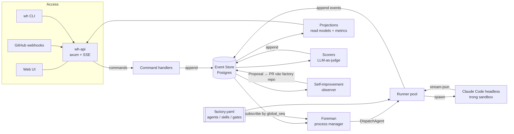
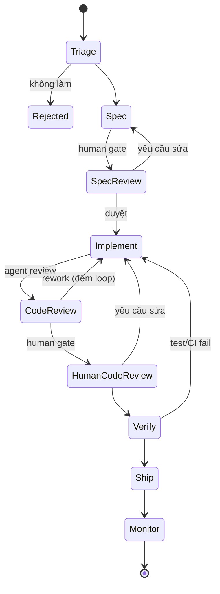

# WorkHub — Thiết kế kiến trúc (đề xuất v0.1)

> WorkHub là một **agent factory**: nơi các agent Claude phối hợp đi hết vòng đời một task (triage → spec → implement → review → verify → ship), mọi bước đều phát sinh **event**. Từ dòng event đó, WorkHub đo lường (chi phí, thời gian, tỉ lệ fail, số lần làm lại, số lần người phải can thiệp) và **feed ngược lại cho một agent cải tiến** để đề xuất thay đổi quy trình.
>
> Ngôn ngữ: **Rust**. Phong cách: **event-driven, event sourcing + CQRS**.

---

## 1. Nguyên tắc thiết kế

1. **Event là nguồn sự thật duy nhất.** Mọi thay đổi trạng thái (task, run, gate, đề xuất) được ghi thành event bất biến vào event store. Bảng đọc (dashboard, danh sách run) chỉ là *projection* có thể xoá và dựng lại.
2. **Đo lường là sản phẩm phụ miễn phí.** Vì mọi bước đã là event, metrics không cần instrument riêng — chỉ cần thêm projection.
3. **Factory-as-code.** Quy trình (stage, gate, agent, prompt/skill, model, budget) nằm trong file version-controlled. Mỗi run ghi lại `factory_version` → so sánh được trước/sau một thay đổi quy trình.
4. **Human-in-the-loop ở các gate.** Spec, code, product đều có điểm duyệt; agent cải tiến *chỉ đề xuất*, con người duyệt.
5. **Agent runtime là plugin.** Lõi không phụ thuộc Claude Code; Claude Code headless là adapter đầu tiên.

---

## 2. Bức tranh tổng thể



Map với "The Factories Stack" của Warp Factories (sản phẩm tham khảo):

| Tầng (Warp) | Thành phần WorkHub |
|---|---|
| 00 Factories-as-code | `factory.yaml`, agent definitions, automation definitions, runner config — crate `wh-factory` |
| 01 Data & context | Event store, transcripts, artifacts (PR, report), memory — `wh-eventstore`, `wh-artifacts` |
| 02 Compute | Runner + sandbox (git worktree → Docker) — `wh-runner` |
| 03 Inference | Model routing theo agent/stage trong factory config |
| 04 Improvement | Metrics projections, Scorers, Benchmarks, Self-improvement — `wh-metrics`, `wh-scorer`, `wh-improver` |
| 05 Orchestration | Foreman (triage/spec/impl/review/verify), automations (trigger/cron), human gates — `wh-foreman` |
| 06 Access | Web UI, API, CLI, GitHub (sau: Slack, Linear/Jira, MCP server) — `wh-api` |

---

## 3. Mô hình miền (domain)

| Aggregate | Ý nghĩa | Stream id |
|---|---|---|
| **Factory** | Một quy trình + repo đích (vd. "wilson") | `factory-{id}` |
| **Task** | Một work item đi qua các stage (idea/bug → shipped) | `task-{id}` |
| **Run** | Một lần thực thi top-level cho task (có thể chứa nhiều agent session) | `run-{id}` |
| **AgentSession** | Một lần chạy một agent cụ thể (triage, spec, code, review…) | `session-{id}` |
| **Gate** | Điểm duyệt của người (spec/code/product) | thuộc stream Task |
| **ScoreResult** | Kết quả chấm một session/run bởi scorer | `score-{id}` |
| **Proposal** | Đề xuất cải tiến từ improver + trạng thái duyệt | `proposal-{id}` |

Quan hệ: `Factory 1─n Task 1─n Run 1─n AgentSession`; `AgentSession 1─n ScoreResult`; `Proposal n─n (Session làm bằng chứng)`.

### Vòng đời Task (state machine trong Foreman)



Mỗi stage và gate đều có thể cấu hình bật/tắt, agent nào, model nào, budget/timeout bao nhiêu trong `factory.yaml`.

---

## 4. Event model

### 4.1 Envelope (chung cho mọi event)

```rust
pub struct EventEnvelope {
    pub event_id: Uuid,          // UUIDv7 — sắp xếp theo thời gian
    pub global_seq: i64,         // thứ tự toàn cục, do store cấp
    pub stream_id: String,       // "task-…", "session-…"
    pub stream_version: i64,     // optimistic concurrency
    pub event_type: String,      // "AgentSessionCompleted"
    pub schema_version: u16,     // để upcast khi payload thay đổi
    pub payload: serde_json::Value,
    pub meta: EventMeta,
}

pub struct EventMeta {
    pub occurred_at: DateTime<Utc>,
    pub factory_id: FactoryId,
    pub factory_version: String, // git sha của factory-as-code → so sánh A/B
    pub correlation_id: Uuid,    // = task_id: gom mọi thứ của một task
    pub causation_id: Option<Uuid>, // event gây ra event này → dựng cây nhân quả
    pub actor: Actor,            // Human{user} | Agent{session} | System{component}
}
```

`correlation_id` + `causation_id` là chìa khoá để timeline (như màn Run detail của Warp) và phân tích "vì sao task này tốn 13h".

### 4.2 Danh mục event chính

**Task**: `TaskCreated{source, title, body}`, `TaskTriaged{priority, kind, estimate}`, `StageEntered{stage}`, `StageExited{stage, outcome}`, `GateRequested{gate}`, `GateDecided{gate, decision, reviewer, comment}`, `TaskShipped{pr_url}`, `TaskCancelled{reason}`.

**Run / AgentSession** (giàu dữ liệu nhất — đây là nguyên liệu cải tiến):
- `AgentDispatched{agent, model, stage, prompt_ref, skills, budget}`
- `AgentSessionStarted{runner_id, sandbox}`
- `AgentToolCalled{tool, duration_ms, ok}` *(ghi tóm tắt; transcript đầy đủ lưu artifact)*
- `AgentUsageReported{input_tokens, output_tokens, cache_read, cache_write, cost_usd}` *(cộng dồn hoặc cuối phiên)*
- `HumanInterventionRecorded{kind: follow_up|steer|handoff, by}`
- `AgentSessionCompleted{outcome, num_turns, duration_ms, cost_usd, artifacts[]}`
- `AgentSessionFailed{failure_class, message, retryable}`

**Quality / Improvement**: `ScoreRecorded{scorer, target_session, pass, score, classification, cost_usd}`, `BenchmarkRunCompleted{suite, variant, results}`, `ProposalCreated{title, rationale, evidence[], diff_ref}`, `ProposalDecided{approved|rejected, by}`, `ProposalRolledOut{factory_version}`.

### 4.3 Phân loại lỗi (`failure_class`)

Cần cố định từ đầu để thống kê tỉ lệ fail có ý nghĩa:
`timeout` · `budget_exceeded` · `tool_error` · `test_failed` · `ci_failed` · `review_rejected` · `gate_rejected` · `spec_ambiguous` · `env_setup` · `agent_gave_up` · `infra` · `unknown`.

---

## 5. Thành phần

### 5.1 Event store (`wh-eventstore`)
- **Postgres** là store + bus cho MVP: bảng `events` append-only, `global_seq BIGSERIAL`, unique `(stream_id, stream_version)` để chống ghi đè đồng thời.
- Subscriber đọc theo `global_seq > checkpoint`, lưu checkpoint riêng mỗi consumer (`consumer_checkpoints`) → **at-least-once**, handler phải idempotent (khóa theo `event_id`).
- `LISTEN/NOTIFY` để đánh thức consumer thay vì poll dày.
- Khi cần scale/phân tán: thêm **NATS JetStream** phía sau qua outbox — interface `EventBus` trừu tượng sẵn từ đầu.

### 5.2 Foreman (`wh-foreman`) — process manager
- Nghe event Task/Session, đọc state machine từ factory config, phát **command** (`DispatchAgent`, `RequestGate`, `AdvanceStage`, `RetrySession`).
- Không gọi LLM để điều phối trong MVP (deterministic, rẻ, dễ debug). Sau này có thể thêm "LLM foreman" cho quyết định mềm (vd. có cần spec không).
- Áp chính sách: retry tối đa N, giới hạn rework loop, budget mỗi task, escalate sang người.

### 5.3 Runner (`wh-runner`)
- Nhận `DispatchAgent`, tạo sandbox (MVP: **git worktree** riêng mỗi session; sau: Docker/K8s), chạy agent, đọc stream, phát event.
- **Adapter Claude Code headless** (MVP): spawn `claude -p <prompt> --output-format stream-json` với `--model`, allowed tools, system prompt/skills theo agent definition. Parse từng dòng JSON → `AgentToolCalled`, `AgentUsageReported`; message `result` cuối cho cost, duration, num_turns.
- Trait `AgentRuntime` để thêm adapter khác (Claude API trực tiếp, Codex…) mà không đổi lõi.
- Transcript đầy đủ → `wh-artifacts` (filesystem/S3), event chỉ giữ tham chiếu.

### 5.4 Projections & Metrics (`wh-metrics`)
Read model trong Postgres (bảng riêng, dựng lại được từ event):

| Read model | Câu hỏi trả lời |
|---|---|
| `runs_view` | Danh sách run + trạng thái (Running/Complete/Failed/Blocked/Cancelled) |
| `run_timeline` | Gantt các session trong một run (như màn Run detail của Warp) |
| `session_facts` | 1 dòng / session: agent, model, stage, tokens, cost, duration, outcome, failure_class, factory_version |
| `task_cycle_times` | kickoff→PR, PR→first human review, review→merge, kickoff→merge |
| `stage_stats` | theo stage/agent: success rate, p50/p95 duration, cost TB, rework rate |
| `human_load` | số lần người can thiệp / PR, gate reject rate |

`session_facts` là bảng "fact" phẳng — cũng là input chính cho improver. Khi dữ liệu lớn, đẩy sang DuckDB/ClickHouse.

### 5.5 Scorers (`wh-scorer`)
- Scorer = định nghĩa trong factory repo: `target` (agent nào), `prompt` chấm, `pass_threshold`, `sampling_rate`.
- Nghe `AgentSessionCompleted` → chạy LLM-as-judge (model rẻ) trên transcript/diff → `ScoreRecorded`. Tự ghi cost của chính scorer (như "All-time scorer cost" của Warp).
- Ví dụ scorer của Warp: *Redundant Tests*, *Status Update Nudge*, *Computer-Use Ask*.

### 5.6 Self-improvement (`wh-improver`)

Vòng lặp:

```
Observe  → định kỳ/khi vượt ngưỡng: đọc session_facts + score fail + gate reject + transcript mẫu
Diagnose → agent phân tích pattern (vd. "implement fail ci 30% vì quên chạy fmt")
Propose  → ProposalCreated: diff vào factory repo (prompt, skill, CLAUDE.md, gate, model, budget)
           kèm evidence (session ids) + kỳ vọng định lượng
Review   → con người duyệt trong Inbox (Warp hiển thị approval rate, vd. 13/51)
Rollout  → merge → factory_version mới
Measure  → so sánh metrics trước/sau theo factory_version; benchmark suite nếu có
```

- Đề xuất **luôn là PR** vào factory repo → audit được, revert được.
- Improver tự đo hiệu quả bản thân: approval rate, cost, và delta metrics sau rollout.

### 5.7 Benchmarks (giai đoạn sau)
Tập task cố định (có lời giải/đánh giá) để chạy lại với các biến thể (model, skill, prompt) → so sánh khách quan trước khi rollout.

### 5.8 API & UI (`wh-api`, `web/`)
- **axum** REST + **SSE** để stream event live (timeline, trạng thái run).
- Màn hình (theo Warp Factories): Inbox (gate + proposal cần duyệt), Runs, Run detail (transcript + Timeline/Agents/Artifacts/Metadata), Dashboard (Productivity / Spending / Scorers), Agents, Scorers, Self-improvement, Factory definition (read-only, link về repo).

---

## 6. Factory-as-code (ví dụ)

```yaml
# factory/factory.yaml
name: workhub-dev
repo: github.com/<org>/<repo>
defaults:
  model: claude-sonnet-5-5
  budget_usd_per_task: 5.0
  max_rework_loops: 3

stages:
  - id: triage
    agent: triage
  - id: spec
    agent: spec
    gate: { kind: human, name: spec-review }
    skip_if: "task.kind == 'bug' && task.estimate == 'small'"
  - id: implement
    agent: implementation
    timeout: 45m
  - id: code_review
    agent: code-review
    on_reject: implement
  - id: human_review
    gate: { kind: human, name: code-review }
  - id: verify
    agent: verify
    on_fail: implement

agents:
  triage:         { file: agents/triage.md,  model: claude-haiku-5-5 }
  spec:           { file: agents/spec.md }
  implementation: { file: agents/implementation.md, skills: [skills/rust-fmt-check] }
  code-review:    { file: agents/code-review.md, model: claude-opus-5-5 }
  verify:         { file: agents/verify.md }

scorers:
  - id: redundant-tests
    target: implementation
    file: scorers/redundant-tests.md
    sampling_rate: 0.5

improvement:
  schedule: "0 2 * * *"
  triggers:
    - metric: stage_failure_rate
      stage: implement
      above: 0.25
```

---

## 7. Cấu trúc Rust workspace

```
WorkHub/
├── Cargo.toml                # [workspace]
├── crates/
│   ├── wh-core/              # types, IDs, Event enum, Command enum, failure_class
│   ├── wh-eventstore/        # Postgres store, subscriptions, checkpoints, EventBus trait
│   ├── wh-factory/           # parse + validate factory.yaml, state machine definition
│   ├── wh-foreman/           # process manager
│   ├── wh-runner/            # sandbox + AgentRuntime trait + claude_code adapter
│   ├── wh-metrics/           # projections / read models
│   ├── wh-scorer/
│   ├── wh-improver/
│   ├── wh-artifacts/         # transcript / diff / report storage
│   ├── wh-api/               # axum, SSE
│   └── wh-cli/               # `wh` binary: task create, run, replay projection…
├── bins/workhubd/            # binary chạy mọi component trong 1 process (MVP)
├── migrations/               # sqlx migrations
├── factory/                  # factory-as-code cho chính WorkHub (dogfooding)
└── web/                      # UI
```

MVP chạy **một binary** (`workhubd`) chứa mọi consumer dưới dạng tokio task; ranh giới crate cho phép tách thành service sau mà không đổi code miền.

**Stack**: `tokio`, `axum`, `sqlx` (Postgres), `serde`/`serde_json`, `uuid` (v7), `chrono`, `tracing` + OpenTelemetry, `thiserror`/`anyhow`, `clap` (CLI).

---

## 8. Lộ trình

| Phase | Mục tiêu | Kết quả kiểm chứng |
|---|---|---|
| **0. Nền** ✅ | Workspace, event store, envelope, migrations, CLI replay | Ghi/đọc event, dựng lại projection từ đầu |
| **1. Một agent** ✅ | Runner + adapter Claude Code, `session_facts` | `wh run "task…"` → thấy cost/tokens/duration/outcome |
| **2. Pipeline** ✅ | Foreman + factory.yaml, triage→spec→implement→review→verify, gate qua CLI | Một task đi hết vòng, có rework loop |
| **3. Quan sát** | API + SSE + UI: Runs, Run timeline, Dashboard | Xem live, metrics cycle time/cost/fail rate |
| **4. Chất lượng** | Scorers | Pass rate theo scorer, cost scorer |
| **5. Tự cải tiến** | Improver + Inbox duyệt + so sánh theo factory_version | Proposal → PR → đo delta |
| **6. Mở rộng** | Benchmarks, GitHub/Slack/Linear, Docker sandbox, NATS | — |

Nên **dogfood** từ phase 2: dùng WorkHub để phát triển chính WorkHub.

---

## 9. Quyết định đã chốt (2026-11-24)

1. **UI**: React + TypeScript + shadcn/ui (thư mục `web/`, bắt đầu ở phase 3).
2. **Triển khai**: local một máy — Postgres trong Docker (`docker-compose.yml`) + binary Rust.
3. **Nguồn task**: task nội bộ WorkHub, tạo qua CLI `wh` (sau là UI). GitHub để sau.
4. **Sandbox**: git worktree mỗi agent session.

### Ghi chú triển khai event store
- Mọi lệnh append lấy một **advisory lock toàn cục** trong transaction → `global_seq` tăng đúng theo thứ tự commit, consumer đọc `global_seq > checkpoint` không bao giờ bỏ sót event. Đủ cho chạy local; khi cần throughput cao sẽ thay bằng cơ chế khác.
- Bảng `events` có trigger chặn UPDATE/DELETE.
- `factory_id`/`factory_version` trong `EventMeta` tạm là `Option` cho tới khi có `wh-factory` (phase 2).

### Ghi chú phase 1 (Runner)
- Chưa có aggregate `Run`: session gắn trực tiếp vào task qua `AgentDispatched.task_id`. Run sẽ do Foreman tạo ở phase 2.
- Runner chạy Claude Code với `--strict-mcp-config` (không nạp MCP cá nhân → tiết kiệm context), `--max-budget-usd` (chặn chi phí), `--no-session-persistence`; timeout do Runner tự kill process.
- `--max-turns` không có trong CLI hiện tại nên dùng budget + timeout để giới hạn.
- **Retry**: tối đa 2 lần chạy lại (tổng 3 lần) cho lỗi `retryable` (timeout, unknown); budget/env_setup không retry. Mỗi lần là session mới trên worktree sạch, `AgentDispatched` ghi `attempt` + `retry_of` → đo được retry rate. Task chỉ thấy một `StageEntered`/`StageExited`. Ở phase 2, chính sách retry sẽ chuyển vào `factory.yaml` do Foreman áp dụng.

### Ghi chú phase 2 (Foreman + factory)
- `factory_version` = sha256 (12 hex) của `factory.yaml` + toàn bộ prompt agent — đổi một chữ trong prompt là ra version mới.
- Mỗi task một branch `wh/task/<id>`; runner commit khi stage thành công → stage sau thấy code stage trước. Stage fail thì worktree bị xoá, thay đổi bị bỏ.
- Verdict: stage có `on_reject` bắt buộc kết thúc bằng `VERDICT: APPROVE|REJECT`; thiếu verdict = stage failed → blocked.
- Chính sách: thành công → gate (nếu có) hoặc stage kế / hoàn thành; REJECT → `on_reject` kèm feedback, quá `max_rework_loops` → blocked; failed (sau retry) → blocked; gate reject → chạy lại chính stage đó với comment.
- Khôi phục: foreman khởi động sẽ block task đang dở `StageEntered` (lý do `interrupted`) và fail session mồ côi; `wh task resume` chạy lại đúng stage đó.
- Chạy thật trên repo demo (Haiku, $0.029 cho 7 session) phát hiện vấn đề quy trình đầu tiên: agent implement thiếu quyền `chmod` (`acceptEdits`, không có `allowed_tools`) nên review reject liên tục tới khi chạm giới hạn — đúng loại dữ liệu mà improver (phase 5) sẽ dùng.
